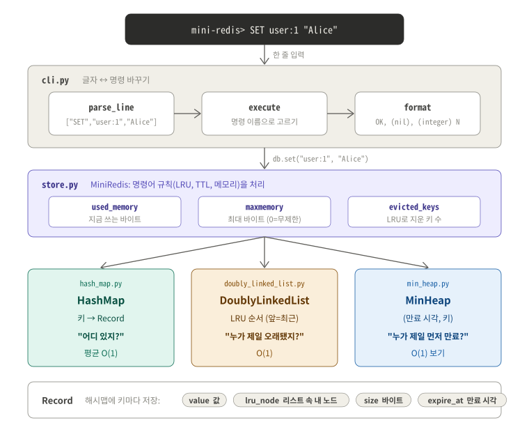
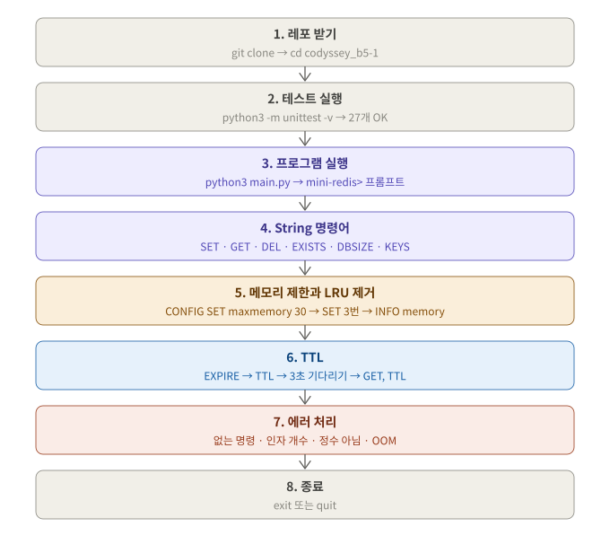
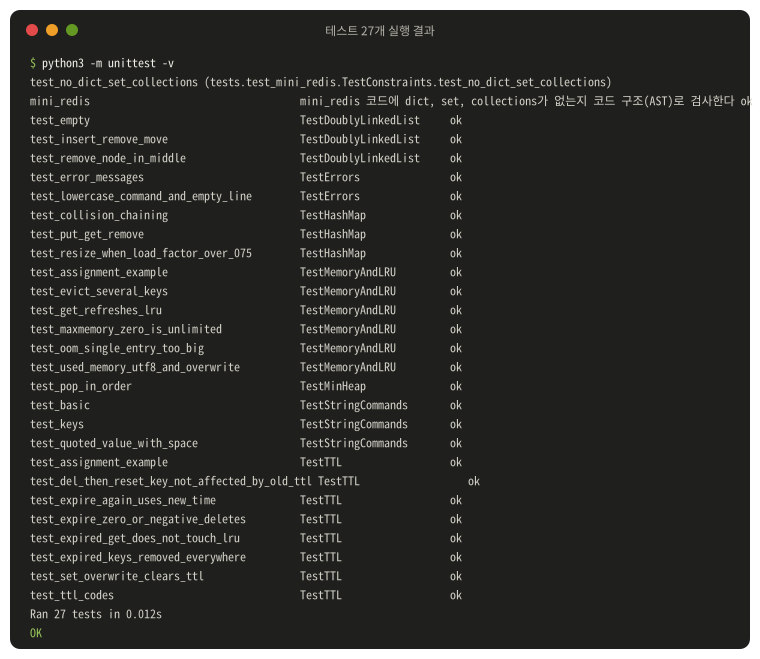
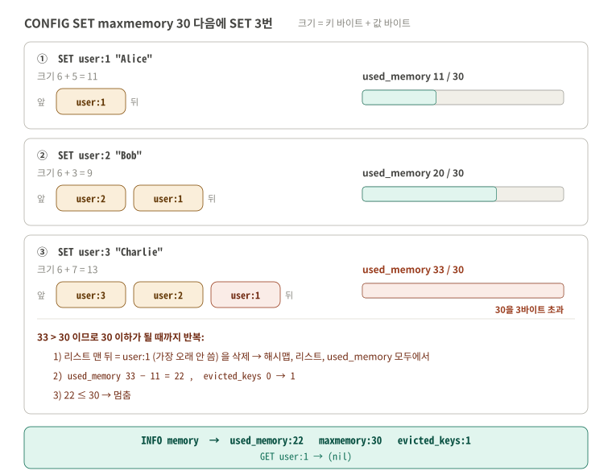
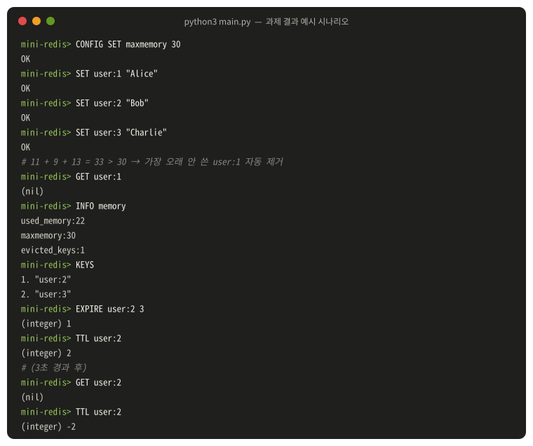
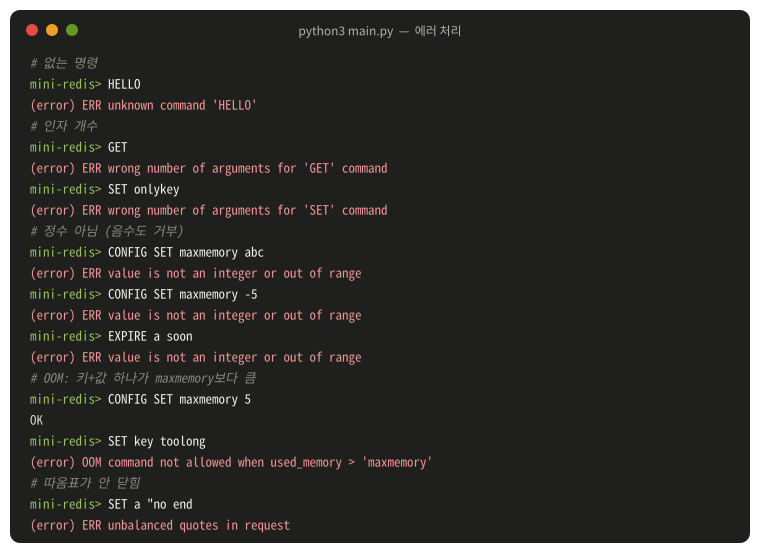

# B5-1 · 정보를 엄청 빠르게 찾아주는 작은 저장소 만들기

| 분야 | 구분 | 학습시간 | 필수/선택 |
|---|---|---|---|
| AI/SW 기초 | 자료구조와 알고리즘 | 80시간 | 필수 |

**결과물: CLI로 동작하는 Mini Redis / 언어: Python 3.8 이상 (외부 라이브러리 없음) / 범위: 필수 요구사항만 (보너스 제외)**

`dict`, `set`, `collections`를 쓰지 않고 **해시맵, 이중 연결 리스트, 최소 힙을 직접 만들어서** Redis의 핵심 기능(String 명령어, LRU 자동 제거, TTL 만료)을 구현했습니다.

이 README는 세 부분으로 되어 있습니다.

| 순서 | 섹션 | 내용 |
|---|---|---|
| 1 | [구조 설계](#구조-설계) | Redis가 빠른 이유, 파일 구성, 자료구조 3개가 각각 맡은 일 |
| 2 | [실행과 확인 흐름](#실행과-확인-흐름) | 레포 받기부터 LRU, TTL, 에러까지 따라 하는 8단계 (실제 출력 포함) |
| 3 | [과제 요구사항 대응](#과제-요구사항-대응) | 과제 문서의 요구마다 어디에 구현했고 어디서 확인하는지 |

> **평가하시는 분은 [구조 설계](#구조-설계)로 그림을 먼저 보고, [실행과 확인 흐름](#실행과-확인-흐름)을 1단계부터 따라 하면 됩니다.**

| 함께 보는 문서 | 내용 |
|---|---|
| [docs/evaluation.md](docs/evaluation.md) | **평가표 항목 1~4 정리.** 질문마다 보여줄 곳(그림, 코드 위치)과 말하기 예시 |
| [docs/concepts.md](docs/concepts.md) | 해시맵, 이중 연결 리스트, 힙, LRU, TTL 개념을 그림으로 쉽게 설명 |

## 진행 상황

| 단계 | 할 일 | 파일 | 상태 |
|---|---|---|---|
| A. 자료구조 | 이중 연결 리스트, 해시맵(체이닝, 0.75 확장), 최소 힙을 각각 다른 파일로 | `mini_redis/doubly_linked_list.py`, `hash_map.py`, `min_heap.py` | ✅ |
| B. 저장소 | String 명령어 6개, maxmemory + LRU 제거, EXPIRE/TTL | `mini_redis/store.py` | ✅ |
| C. CLI | `mini-redis>` 프롬프트, 따옴표 파싱, Redis 스타일 출력, 에러 4종 | `mini_redis/cli.py`, `main.py` | ✅ |
| D. 테스트 | 요구사항과 엣지 케이스 27개 | `tests/test_mini_redis.py` | ✅ 27개 통과 |
| E. 문서 | 개념 정리, 평가 항목 정리, 그림 22장 | `docs/` | ✅ |

---

## 구조 설계

### 컨셉: Redis가 빠른 이유 = 메모리 + 알맞은 자료구조

Redis는 데이터를 디스크가 아니라 **메모리**에 둡니다. 그런데 메모리에 있어도, 100만 개 중 하나를 찾으려고 처음부터 하나씩 비교하면 느립니다.
그래서 Redis는 할 일마다 **"한 번에 찾을 수 있는" 자료구조**를 골라 씁니다. 이 미션은 그중 세 가지를 직접 만듭니다.

| 질문 | 맡은 자료구조 | 비유 | 걸리는 시간 |
|---|---|---|---|
| "user:1 어디 있지?" | **해시맵** | 이름으로 사물함 번호를 바로 계산 | 평균 O(1) |
| "누가 제일 오래 안 쓰였지?" | **이중 연결 리스트** | 줄 서기. 쓰면 맨 앞으로, 맨 뒤가 가장 오래된 사람 | O(1) |
| "누가 제일 먼저 만료되지?" | **최소 힙** | 마감이 가장 빠른 숙제가 항상 맨 위에 오는 더미 | O(1)로 보기 |

> **O(1)** = 데이터가 10개든 100만 개든 걸리는 시간이 거의 같다. **O(n)** = 데이터가 많을수록 그만큼 오래 걸린다.

### 전체 구조

입력 한 줄은 **cli.py가 나누고 → store.py가 규칙대로 처리하고 → 자료구조 3개에 저장**됩니다.



| 파일 | 하는 일 | 핵심 |
|---|---|---|
| [`main.py`](main.py) | 실행 진입점 (`python3 main.py`) | `run()` 호출 한 줄 |
| [`mini_redis/cli.py`](mini_redis/cli.py) | 입력 나누기, 명령 고르기, Redis 스타일 출력, 에러 메시지 | `parse_line`, `execute`, `run` |
| [`mini_redis/store.py`](mini_redis/store.py) | 명령어 규칙: LRU 제거, TTL 만료, used_memory 계산 | `MiniRedis` |
| [`mini_redis/hash_map.py`](mini_redis/hash_map.py) | 키 → Record 저장. 직접 만든 해시 함수 + 체이닝 + 2배 확장 | `HashMap`, `hash_string` |
| [`mini_redis/doubly_linked_list.py`](mini_redis/doubly_linked_list.py) | LRU 순서 기록 + 해시맵 버킷의 체인으로 **재사용** | `DoublyLinkedList` |
| [`mini_redis/min_heap.py`](mini_redis/min_heap.py) | (만료 시각, 키)를 만료가 빠른 순서로 | `MinHeap` |
| [`tests/test_mini_redis.py`](tests/test_mini_redis.py) | 요구사항 확인 테스트 27개 | 가짜 시계로 TTL을 기다리지 않고 확인 |

### 키 하나가 저장되는 모습 (Record)

해시맵에는 키마다 **Record** 하나가 들어갑니다. Record가 LRU 리스트 속 자기 노드(`lru_node`)를 기억하기 때문에, 리스트를 뒤지지 않고 바로 옮기거나 뺄 수 있습니다.

| Record 칸 | 뜻 | 예 (`SET user:1 "Alice"` 직후) |
|---|---|---|
| `value` | 저장한 값 | `"Alice"` |
| `lru_node` | LRU 리스트 안의 내 노드 | 리스트 맨 앞 노드 |
| `size` | `len(utf8(key)) + len(utf8(value))` | 6 + 5 = **11** |
| `expire_at` | 만료 시각(초). 없으면 `None` | `None` |

### 자료구조 3개 요약

자세한 설명과 그림은 [docs/concepts.md](docs/concepts.md)에 있습니다.

| 자료구조 | 요구 메서드 (모두 구현) | 이 프로젝트에서의 역할 | 개념 |
|---|---|---|---|
| 이중 연결 리스트 | `insert_front`, `insert_back`, `remove_front`, `remove_back`, `remove_node`, `move_to_front` | ① LRU 순서 (앞 = 최근) ② 해시맵 버킷 체인 | [보기](docs/concepts.md#2-이중-연결-리스트) |
| 해시맵 | `put`, `get`, `remove`, `contains`, `keys`, `size` | 키 → Record | [보기](docs/concepts.md#1-해시맵) |
| 최소 힙 | `push`, `pop`, `peek`, `size`, `_heapify_up`, `_heapify_down` | (만료 시각, 키) 중 가장 빠른 것 찾기 | [보기](docs/concepts.md#4-최소-힙) |

### 직접 정한 것 (과제가 열어 둔 부분)

| 정한 것 | 이유 |
|---|---|
| 명령 이름은 대소문자 구분 안 함 (`set` = `SET`) | 실제 Redis와 같게 |
| EXISTS, TTL, EXPIRE는 LRU 순서를 바꾸지 않음 | 과제가 "SET, GET 성공 시"에만 갱신하라고 함 |
| TTL은 남은 초의 **소수점을 버림** | 과제 예시처럼 `EXPIRE 3` 직후 `TTL`이 `2` |
| 만료 키는 **명령어가 올 때마다** 힙 맨 위부터 정리 | DBSIZE, KEYS, INFO도 만료된 키를 세지 않도록 |
| 힙에서는 바로 지우지 않고 꺼낼 때 버림 (lazy deletion) | 힙 가운데 항목 찾기는 O(n). 과제에서 허용한 방식 ([설명](docs/concepts.md#5-ttl-만료-관리)) |
| maxmemory를 줄여도 그 자리에서 지우지 않음 | 과제 규칙이 "SET 이후" 초과 시 제거. 다음 SET 때 맞춰짐 |
| 값에 공백이 있으면 큰따옴표: `SET msg "hello world"` | 과제 최소 요구(공백 없는 값 / 따옴표 값) 둘 다 지원. 따옴표가 안 닫히면 에러 |
| `INFO`와 `INFO memory` 모두 메모리 정보 출력 | 메모리 항목만 구현했기 때문 |

---

## 실행과 확인 흐름

**레포 받기 → 테스트 → 실행 → 명령어를 기능별로 확인** 순서입니다. 각 단계의 출력은 실제 실행 결과입니다.



**어디에 입력하나요?**

| 표시 | 어디 | 언제 |
|---|---|---|
| `$` | 터미널 | 1~3단계 |
| `mini-redis>` | `python3 main.py`를 실행한 뒤 나오는 화면 | 4~8단계 |

- 아래 예시는 모두 **새로 실행한 `mini-redis>`** 기준입니다. 예시마다 `exit` 후 `python3 main.py`로 다시 열면 출력이 똑같이 나옵니다. (6단계의 "3초 기다린 뒤"만 바로 앞 입력에 이어서)
- 프로그램을 닫으면 데이터는 사라집니다 (파일 저장은 과제 범위 밖).

### 1단계. 레포 받기

**무엇을**: 레포를 받고 그 폴더로 이동합니다.
**왜**: `python3 main.py`가 **지금 있는 폴더**에서 `mini_redis` 폴더를 찾기 때문입니다.

```bash
git clone https://github.com/codewhite7777/codyssey_b5-1.git
cd codyssey_b5-1
python3 --version
ls
```

**결과**: `Python 3.8` 이상, `README.md  docs  main.py  mini_redis  tests`가 보이면 됩니다. 설치할 라이브러리는 없습니다.

### 2단계. 테스트 실행하기

**무엇을**: 요구사항을 자동으로 확인하는 테스트 27개를 돌립니다.
**왜**: 손으로 확인하기 어려운 것(확장이 0.75에서 일어나는지, 낡은 TTL이 키를 지우지 않는지 등)을 한 번에 확인하기 위해서입니다.

```bash
python3 -m unittest -v
```

**결과**: 마지막에 `Ran 27 tests` 와 `OK`



| 테스트 묶음 | 확인하는 것 |
|---|---|
| `TestDoublyLinkedList` | 앞뒤 넣기/빼기, 가운데 노드 빼기, `move_to_front`, 빈 리스트 |
| `TestHashMap` | 넣기/덮어쓰기/지우기, **충돌한 두 키가 같은 칸에서 따로 찾아지는지**, **7번째 키에서 8칸 → 16칸** |
| `TestMinHeap` | 아무 순서로 넣어도 작은 것부터 나오는지 |
| `TestStringCommands` | 6개 명령어 출력 형식, 공백 있는 따옴표 값 |
| `TestMemoryAndLRU` | 과제 예시(22/30/1), GET이 LRU 순서를 바꾸는지, 여러 개 제거, OOM, UTF-8 바이트 계산 |
| `TestTTL` | 과제 예시, -1/-2, 0 이하 즉시 삭제, **SET 덮어쓰기 후 낡은 TTL이 키를 지우지 않는지**, DEL 후 재생성 |
| `TestErrors` | 에러 4종 + 따옴표 안 닫힘, 소문자 명령, 빈 줄 |
| `TestConstraints` | `mini_redis/` 코드에 `dict`, `set`, `collections`가 없는지 코드 구조(AST)로 검사 |

TTL 테스트는 **가짜 시계**(`FakeClock`)로 시간을 직접 앞으로 보내서, 3초를 실제로 기다리지 않습니다.

### 3단계. 프로그램 실행하기

```bash
python3 main.py
```

**결과**: `mini-redis>` 프롬프트가 나오면 명령어를 입력할 수 있습니다. 끝낼 때는 `exit` 또는 `quit` (8단계).

### 4단계. String 명령어 6개

**무엇을**: SET, GET, DEL, EXISTS, DBSIZE, KEYS를 차례로 입력합니다.
**왜**: 저장, 조회, 삭제, 존재 확인, 개수, 목록이 Redis 스타일 출력(`OK`, `"값"`, `(nil)`, `(integer) N`)으로 나오는지 보기 위해서입니다.

```text
mini-redis> SET user:1 "Alice"
OK
mini-redis> SET msg "hello world"
OK
mini-redis> GET user:1
"Alice"
mini-redis> GET msg
"hello world"
mini-redis> GET nope
(nil)
mini-redis> EXISTS user:1
(integer) 1
mini-redis> EXISTS nope
(integer) 0
mini-redis> DBSIZE
(integer) 2
mini-redis> KEYS
1. "msg"
2. "user:1"
mini-redis> DEL user:1
(integer) 1
mini-redis> DEL user:1
(integer) 0
mini-redis> DBSIZE
(integer) 1
mini-redis> DEL msg
(integer) 1
mini-redis> KEYS
(empty array)
```

| 확인할 것 | 어디 |
|---|---|
| 없는 키는 `(nil)`, 있으면 따옴표로 감싼 값 | `GET nope`, `GET user:1` |
| 공백이 있는 값은 큰따옴표로 한 덩어리 | `SET msg "hello world"` |
| 두 번째 DEL은 이미 없으니 `0` | `DEL user:1` 두 번 |
| KEYS 순서는 해시맵 칸 순서 (과제: 순서 상관없음) | `msg`가 먼저 나옴 |
| 비어 있으면 `(empty array)` | 마지막 KEYS |

### 5단계. 메모리 제한과 LRU 자동 제거

**무엇을**: 과제 결과 예시를 그대로 입력합니다. (새로 실행한 `mini-redis>`에서)
**왜**: maxmemory를 넘으면 **가장 오래 안 쓴 키**가 자동으로 지워지고, `INFO memory` 숫자가 공식대로 바뀌는지 보기 위해서입니다.

```text
mini-redis> CONFIG SET maxmemory 30
OK
mini-redis> SET user:1 "Alice"
OK
mini-redis> SET user:2 "Bob"
OK
mini-redis> SET user:3 "Charlie"
OK
mini-redis> GET user:1
(nil)
mini-redis> INFO memory
used_memory:22
maxmemory:30
evicted_keys:1
mini-redis> KEYS
1. "user:2"
2. "user:3"
```

**계산**: `used_memory = Σ (키 바이트 + 값 바이트)`. 따옴표는 값에 포함되지 않습니다.



**GET이 순서를 바꾸는지 + OOM** (새로 실행해서 입력). GET으로 user:1을 읽으면 user:1이 "최근"이 되어, 이번에는 **user:2가 지워져야** 합니다.

```text
mini-redis> CONFIG SET maxmemory 30
OK
mini-redis> SET user:1 Alice
OK
mini-redis> SET user:2 Bob
OK
mini-redis> GET user:1
"Alice"
mini-redis> SET user:3 Charlie
OK
mini-redis> KEYS
1. "user:1"
2. "user:3"
mini-redis> INFO memory
used_memory:24
maxmemory:30
evicted_keys:1
mini-redis> SET big 12345678901234567890123456789
(error) OOM command not allowed when used_memory > 'maxmemory'
mini-redis> CONFIG SET maxmemory 0
OK
mini-redis> INFO memory
used_memory:24
maxmemory:0
evicted_keys:1
```

| 확인할 것 | 결과 |
|---|---|
| GET 이후 가장 오래된 키 | user:2 → 제거됨, user:1은 남음 (11 + 13 = **24**) |
| 키 하나가 maxmemory보다 큼 (3 + 29 = 32 > 30) | 다른 키를 지우지 않고 **저장 자체를 거부** (OOM) |
| `maxmemory 0` | 무제한 |

SET 한 번이 지나가는 전체 흐름은 [docs/concepts.md의 SET 흐름도](docs/concepts.md#3-lru--해시맵--이중-연결-리스트)에 있습니다.

### 6단계. TTL (만료 시간)

**무엇을**: 키에 3초 만료를 걸고, 남은 시간을 보고, 3초 뒤 다시 조회합니다. (새로 실행한 `mini-redis>`에서)
**왜**: 만료된 키가 `(nil)`, `-2`로 "없는 키"처럼 처리되는지 보기 위해서입니다.

```text
mini-redis> SET user:2 "Bob"
OK
mini-redis> EXPIRE user:2 3
(integer) 1
mini-redis> TTL user:2
(integer) 2
```

**3초 기다린 뒤**

```text
mini-redis> GET user:2
(nil)
mini-redis> TTL user:2
(integer) -2
```

`EXPIRE 3` 직후 TTL이 `2`인 이유: 입력하는 사이 아주 조금 시간이 지나 2.9xx초가 남았고, 소수점을 버리기 때문입니다.

과제 결과 예시(5단계 + 6단계)를 한 번에 이어서 실행한 화면입니다.



**TTL 규칙 더 보기** (새로 실행해서 입력)

```text
mini-redis> SET a 1
OK
mini-redis> TTL a
(integer) -1
mini-redis> TTL nope
(integer) -2
mini-redis> EXPIRE nope 10
(integer) 0
mini-redis> EXPIRE a 100
(integer) 1
mini-redis> TTL a
(integer) 99
mini-redis> SET a 2
OK
mini-redis> TTL a
(integer) -1
mini-redis> EXPIRE a 0
(integer) 1
mini-redis> EXISTS a
(integer) 0
```

| 규칙 (과제) | 확인한 줄 |
|---|---|
| 키는 있는데 만료 없음 → `-1`, 키 없음 → `-2` | `TTL a`, `TTL nope` |
| 없는 키에 EXPIRE → `0` | `EXPIRE nope 10` |
| SET으로 덮어쓰면 TTL 초기화 | `SET a 2` 후 `TTL a` → `-1` |
| 0 이하 → 즉시 삭제 후 `1` | `EXPIRE a 0` 후 `EXISTS a` → `0` |

### 7단계. 에러 처리

**무엇을**: 일부러 틀린 명령을 넣습니다.
**왜**: 과제의 에러 표준 형식 4가지로 출력되는지 보기 위해서입니다.

```text
mini-redis> HELLO
(error) ERR unknown command 'HELLO'
mini-redis> GET
(error) ERR wrong number of arguments for 'GET' command
mini-redis> CONFIG SET maxmemory abc
(error) ERR value is not an integer or out of range
mini-redis> CONFIG SET maxmemory -5
(error) ERR value is not an integer or out of range
mini-redis> EXPIRE a soon
(error) ERR value is not an integer or out of range
mini-redis> CONFIG SET maxmemory 5
OK
mini-redis> SET key toolong
(error) OOM command not allowed when used_memory > 'maxmemory'
mini-redis> SET a "no end
(error) ERR unbalanced quotes in request
```

| 에러 | 언제 |
|---|---|
| `ERR unknown command '<cmd>'` | 없는 명령 |
| `ERR wrong number of arguments for '<cmd>' command` | 인자 개수가 다름 |
| `ERR value is not an integer or out of range` | maxmemory, EXPIRE 초가 정수가 아님 (maxmemory는 음수도) |
| `OOM command not allowed when used_memory > 'maxmemory'` | 키+값 하나가 maxmemory보다 큼 |
| `ERR unbalanced quotes in request` (추가) | 큰따옴표가 안 닫힘 |



### 8단계. 종료

```text
mini-redis> exit
```

`quit`이나 `Ctrl+D`로도 끝납니다.

---

## 과제 요구사항 대응

| 과제 요구 | 구현 위치 | 확인 |
|---|---|---|
| 이중 연결 리스트: `prev`, `next`, `data` 노드 + 메서드 6개, 모두 O(1) | [`doubly_linked_list.py`](mini_redis/doubly_linked_list.py) `Node`, `DoublyLinkedList` | 2단계 `TestDoublyLinkedList` |
| 해시맵: 메서드 6개, 해시 함수 직접 설계 | [`hash_map.py`](mini_redis/hash_map.py) `hash_string`, `HashMap` | 2단계 `TestHashMap` |
| 체이닝 (권장: 이중 연결 리스트 재사용) | 각 버킷 칸 = `DoublyLinkedList` | `test_collision_chaining` |
| 로드 팩터 0.75 초과 시 2배 | `HashMap.put` → `_resize` | `test_resize_when_load_factor_over_075` |
| 최소 힙: 메서드 4개 + `_heapify_up/down`, `(expire_at, key)` | [`min_heap.py`](mini_redis/min_heap.py) `MinHeap` | `test_pop_in_order` |
| String 명령어 6개, Redis 스타일 출력 | [`store.py`](mini_redis/store.py) + [`cli.py`](mini_redis/cli.py) `execute` | 4단계 |
| 키 기반 명령 전에 만료 확인 | `MiniRedis._get_alive_record` | 6단계 |
| SET 덮어쓰기 → TTL 초기화 | `MiniRedis.set` (`expire_at = None`) | 6단계, `test_set_overwrite_clears_ttl` |
| GET 성공 시에만 LRU 갱신 | `MiniRedis.get` | 5단계, `test_expired_get_does_not_touch_lru` |
| DEL은 데이터/TTL/LRU 모두에서 제거 | `MiniRedis._delete` (힙은 lazy deletion) | `test_del_then_reset_key_not_affected_by_old_ttl` |
| CONFIG SET maxmemory (0 = 무제한), INFO memory 3항목 | `set_maxmemory`, `info_memory` | 5단계 |
| used_memory = Σ(utf8 키 + utf8 값), 오버헤드 제외 | `entry_size` | `test_used_memory_utf8_and_overwrite` |
| 초과 시 LRU부터 제거, evicted_keys 누적 | `MiniRedis._evict_until_fit` | 5단계 |
| 엔트리 하나가 maxmemory 초과 → 저장 안 하고 OOM | `MiniRedis.set` 첫 줄 | 5단계, 7단계 |
| EXPIRE / TTL 규칙 (0, 1, -1, -2, 0 이하 즉시 삭제) | `expire`, `ttl` | 6단계 |
| 힙으로 가장 빠른 만료를 빠르게 찾기 | `MiniRedis._remove_expired_keys` | `test_expired_keys_removed_everywhere` |
| `mini-redis>` REPL, exit/quit, 에러 표준 | [`cli.py`](mini_redis/cli.py) `run`, `ERR_*` | 3단계, 7단계 |
| 따옴표 값 허용 | `parse_line` | 4단계 |
| `dict`, `set`, `collections` 사용 금지 | 코드 전체에서 사용 안 함. 파이썬 `list`는 버킷 고정 길이 배열(`[None] * capacity`)과 힙 배열의 **인덱스 접근**에만 사용 | `test_no_dict_set_collections` (AST 검사) |
| 자료구조마다 독립 파일, docstring | `mini_redis/` 파일 3개 | 각 파일 맨 위 설명 |
| 네트워크, 파일 저장, 복잡 자료형, 동시성 없음 | 구현하지 않음 | - |
| 보너스 과제 | **하지 않음** (필수 범위만) | - |
