# 피어 평가 준비

평가표 항목 1~4의 질문마다 **무엇을 보여주고, 어떻게 답할지**를 정리합니다.

[← README](../README.md) · [개념 정리](concepts.md)

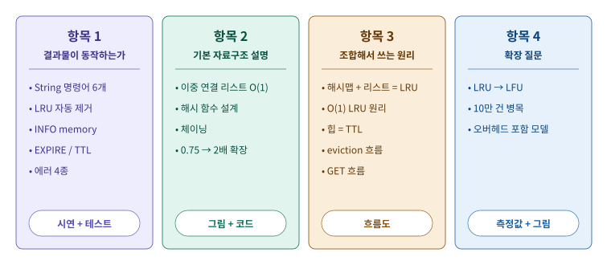

---

## 평가 진행 순서 (시연)

README의 [구조 설계](../README.md#구조-설계) 그림으로 전체를 먼저 보여주고, [실행과 확인 흐름](../README.md#실행과-확인-흐름) 1~8단계를 따라 하면서 아래 질문에 답합니다.

| 순서 | 할 것 | 답하는 항목 |
|---|---|---|
| 1 | README **전체 구조** 그림: 입력 → cli.py → store.py → 자료구조 3개 | 항목 2, 3 |
| 2 | 흐름 **2단계** `python3 -m unittest -v` → 27개 OK | 항목 1 |
| 3 | 흐름 **4단계** String 명령어 6개 | 항목 1 |
| 4 | 흐름 **5단계** 과제 예시로 LRU 제거, `INFO memory` 22 / 30 / 1 | 항목 1, 3 |
| 5 | 흐름 **6단계** EXPIRE 3 → 3초 기다리기 → `(nil)`, `-2` | 항목 1, 3 |
| 6 | 흐름 **7단계** 에러 4종 | 항목 1 |
| 7 | 이 문서의 항목 2~4 질문에 그림을 보여주며 답변 | 항목 2~4 |

---

## 항목 1. 결과물이 요구사항대로 동작하는가

| 평가 질문 | 상태 | 보여줄 곳 |
|---|---|---|
| String 타입 기본 동작: SET, GET, DEL, EXISTS, DBSIZE, KEYS가 모두 정상 동작하는가? | ✅ | [README 4단계](../README.md#4단계-string-명령어-6개), 테스트 `TestStringCommands` |
| LRU 자동 제거: maxmemory 설정 후 초과 시 가장 오래된 키가 자동 제거되는가? | ✅ | [README 5단계](../README.md#5단계-메모리-제한과-lru-자동-제거) (과제 예시 + GET으로 순서가 바뀌는 예) |
| 메모리 정보: INFO memory의 used_memory / maxmemory / evicted_keys가 규칙대로인가? | ✅ 22 / 30 / 1 | [README 5단계](../README.md#5단계-메모리-제한과-lru-자동-제거), `test_assignment_example` |
| TTL 관리: EXPIRE/TTL 규칙이 동작하고 만료된 키가 제거되는가? | ✅ | [README 6단계](../README.md#6단계-ttl-만료-시간), 테스트 `TestTTL` 8개 |
| 에러 처리: 잘못된 명령 / 인자 / 정수 / OOM이 표준 형식인가? | ✅ 4종 + 따옴표 | [README 7단계](../README.md#7단계-에러-처리), `test_error_messages` |

**실행 화면** (모두 실제 실행 결과)

| String 명령어 | GET이 LRU 순서를 바꾸는지 + OOM |
|---|---|
| 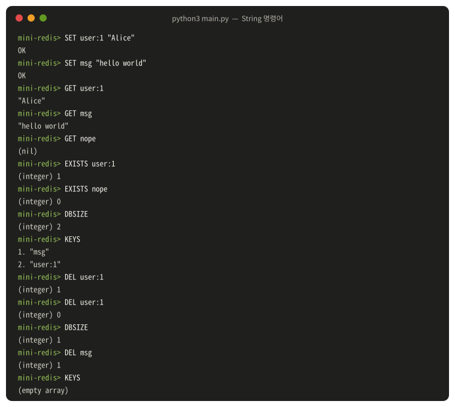 | 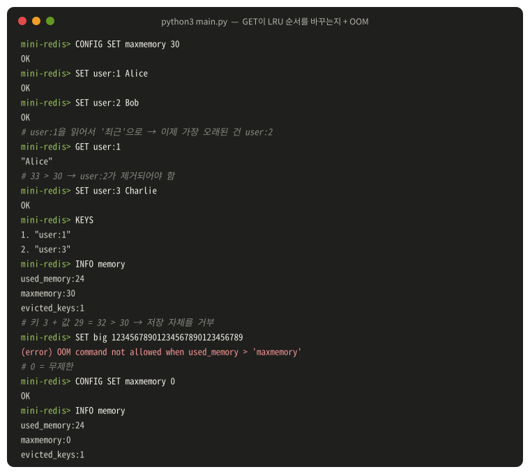 |

| TTL 규칙 | 에러 처리 |
|---|---|
| 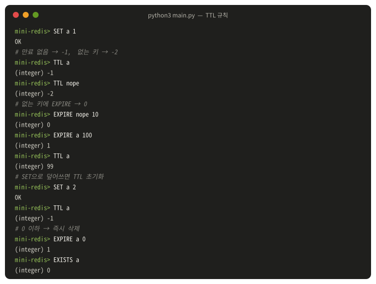 |  |


**말하기**
> "과제 결과 예시를 그대로 넣으면 user:1이 제거되고 INFO memory가 22, 30, 1로 나옵니다. 거기에 더해 GET으로 user:1을 읽은 뒤 SET하면 이번에는 user:2가 지워지는 것도 보여드리겠습니다. 3초 TTL처럼 기다려야 하는 것은 테스트에서 가짜 시계로 확인했고, 테스트 27개가 모두 통과합니다."

---

## 항목 2. 기본 자료구조를 설명할 수 있는가

### Q. 이중 연결 리스트의 노드 구조와 핵심 메서드가 O(1)인 이유는?

**보여줄 곳**: [`doubly_linked_list.py`](../mini_redis/doubly_linked_list.py) `Node`, `_link_after`, `_unlink`

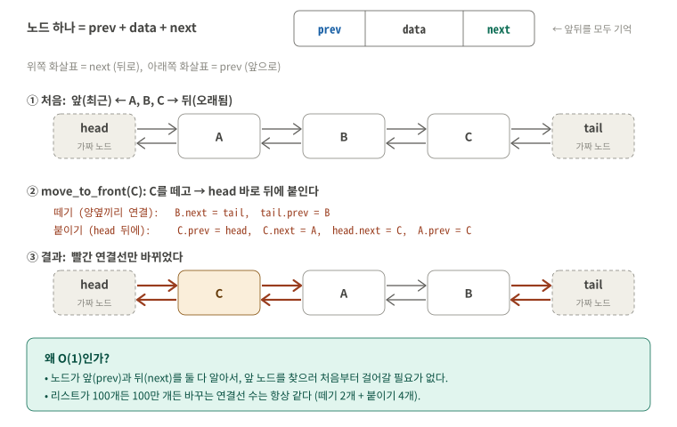

| 구성 | 내용 |
|---|---|
| 노드 | `prev`(앞), `next`(뒤), `data`(값) |
| 양 끝 | 가짜 노드 `head`, `tail` → 빈 리스트, 맨 앞/맨 뒤 예외 처리가 필요 없음 |
| 모든 메서드 | 내부적으로 `_link_after`(연결선 4개) 또는 `_unlink`(연결선 2개)만 사용. 반복문 없음 |

**말하기**
> "노드가 앞과 뒤를 둘 다 기억하기 때문에, 노드 하나만 알면 앞 노드를 찾으러 걸어갈 필요 없이 바로 뗄 수 있습니다. 양 끝에 가짜 노드를 둬서 모든 연산이 '어떤 노드 뒤에 붙이기'와 '떼기' 두 가지로 끝나고, 리스트 길이와 상관없이 바꾸는 연결선 수가 같아서 O(1)입니다."

**꼬리질문 "remove_node는 노드를 어떻게 알아요?"** → "LRU에서는 해시맵의 Record가 자기 노드(`lru_node`)를 들고 있어서, 찾지 않고 바로 넘겨줍니다. 노드를 찾는 일이 필요 없으니 O(1)입니다."

### Q. 직접 설계한 해시 함수는 어떤 입력을 받아 어떤 과정으로 인덱스를 만드나?

**보여줄 곳**: [`hash_map.py`](../mini_redis/hash_map.py) `hash_string`, `_index`

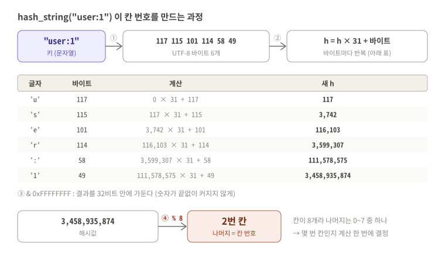

| 단계 | 하는 일 |
|---|---|
| 입력 | 키 문자열 (예: `"user:1"`) |
| ① | UTF-8 바이트로 바꿈 → `[117, 115, 101, 114, 58, 49]` |
| ② | `h = h × 31 + 바이트`를 바이트마다 반복 (다항식 롤링 해시) |
| ③ | `& 0xFFFFFFFF`로 32비트 안에 가둠 → `3,458,935,874` |
| ④ | `% 칸 개수` → 칸 번호 `2` |

**말하기**
> "키를 UTF-8 바이트로 바꾸고, 바이트마다 31을 곱하고 더해서 섞습니다. 곱하기 덕분에 'ab'와 'ba'처럼 글자 순서만 다른 키도 다른 숫자가 나옵니다. 숫자가 너무 커지지 않게 32비트로 자르고, 마지막에 칸 개수로 나눈 나머지를 칸 번호로 씁니다."

**꼬리질문 "왜 31?"** → "홀수인 소수라서 곱했을 때 비트가 고르게 섞이고, 자바 String.hashCode도 같은 방식입니다."

### Q. 충돌 해결을 체이닝으로 어떻게 구현했나? (버킷 내부 구조 선택 포함)

**보여줄 곳**: [`hash_map.py`](../mini_redis/hash_map.py) `_insert_new`, `_find_node`, `remove`

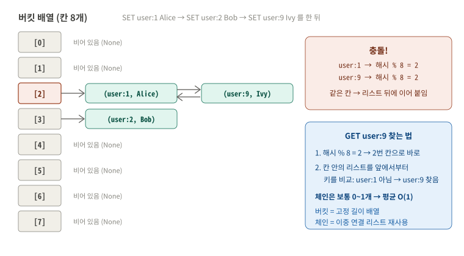

| 선택 | 이유 |
|---|---|
| 버킷 배열 = 길이가 정해진 배열 `[None] * capacity` | 칸 번호로 바로 접근 (인덱스 접근만 사용) |
| 칸 안 = **이중 연결 리스트** (LRU와 같은 클래스 재사용) | 과제 권장. 체인 가운데 항목도 `remove_node`로 바로 뗄 수 있음 |
| 항목 = `Entry(key, value)` | 같은 칸에 여러 키가 있으니 찾을 때 키를 비교 |
| 빈 칸은 `None`, 처음 쓰일 때 리스트 생성 | 빈 칸마다 리스트를 미리 만들지 않음 |

**말하기**
> "칸이 8개일 때 user:1과 user:9는 둘 다 2번 칸이 나옵니다. 이때 2번 칸에 이중 연결 리스트를 두고 뒤에 이어 붙입니다. 찾을 때는 2번 칸으로 바로 가서 그 리스트만 키를 비교하며 훑습니다. 테스트 `test_collision_chaining`이 이 두 키로 확인합니다."

### Q. 로드 팩터 0.75 초과 시 버킷 2배 확장 절차는?

**보여줄 곳**: [`hash_map.py`](../mini_redis/hash_map.py) `put`, `_resize`

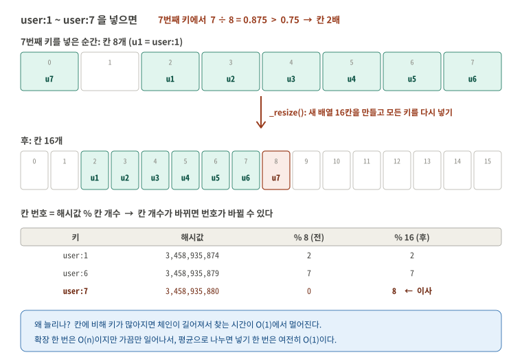

| 순서 | 하는 일 |
|---|---|
| 1 | `put`이 새 키를 넣은 뒤 `키 개수 / 칸 개수`를 계산 |
| 2 | 0.75보다 크면 `_resize()` (칸 8개 기준 7번째 키에서: 7/8 = 0.875) |
| 3 | 칸 개수를 2배로, 새 빈 배열 생성 |
| 4 | 예전 배열의 모든 체인을 돌며 항목을 **새 칸 번호로 다시 계산해서** 넣음 |

**말하기**
> "칸 번호가 '해시값 % 칸 개수'라서 칸 개수가 바뀌면 번호도 바뀝니다. 그래서 복사가 아니라 모든 키를 다시 계산해서 넣습니다. 예를 들어 user:7은 8칸에서 0번이었는데 16칸에서는 8번으로 이사합니다. 확장 한 번은 O(n)이지만 2배씩 늘려서 가끔만 일어나니, 평균으로 나누면 넣기는 O(1)입니다."

---

## 항목 3. 자료구조를 조합한 원리를 설명할 수 있는가

### Q. LRU에서 해시맵과 이중 연결 리스트의 역할, 왜 둘 다 필요한가?

**보여줄 곳**: [`store.py`](../mini_redis/store.py) `Record`, `MiniRedis.__init__`

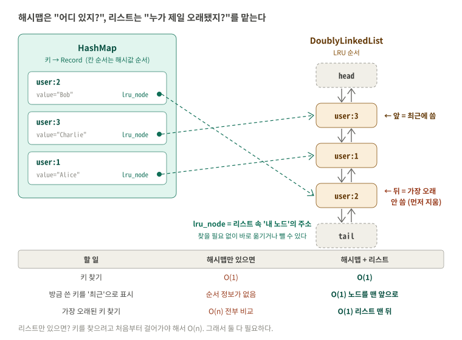

| 자료구조 | 역할 | 혼자 쓰면 |
|---|---|---|
| 해시맵 | 키 → Record를 바로 찾기 | "가장 오래된 키"를 알려면 전부 비교 O(n) |
| 이중 연결 리스트 | 사용 순서 기록 (앞 = 최근, 뒤 = 가장 오래) | 특정 키의 노드를 찾으려면 처음부터 O(n) |

**말하기**
> "해시맵은 '어디 있지?'를, 리스트는 '누가 제일 오래됐지?'를 맡습니다. 둘을 이어 주는 게 Record 안의 `lru_node`입니다. 해시맵에서 Record를 찾으면 리스트 속 노드 주소가 같이 나와서 리스트를 뒤질 필요가 없습니다."

### Q. O(1) LRU 달성 원리를 "조회(해시) + 갱신(리스트 이동)" 관점에서?

| 단계 | 연산 | 시간 |
|---|---|---|
| 조회 | `self._data.get(key)` → Record (안에 `lru_node`) | 평균 O(1) |
| 갱신 | `self._lru.move_to_front(record.lru_node)` | O(1) |
| 제거 대상 찾기 | `self._lru.peek_back()` | O(1) |
| 제거 | `_delete(key)`: 해시맵 `remove` + 리스트 `remove_node` | 평균 O(1) |

**말하기**
> "GET 한 번은 해시로 Record를 O(1)에 찾고, 그 Record가 가진 노드를 리스트 맨 앞으로 O(1)에 옮기는 두 단계입니다. 어느 단계에도 '처음부터 훑기'가 없어서 키가 100만 개여도 같은 시간입니다."

### Q. TTL 관리에 힙을 사용한 이유는?

**보여줄 곳**: [`min_heap.py`](../mini_redis/min_heap.py), [`store.py`](../mini_redis/store.py) `_remove_expired_keys`

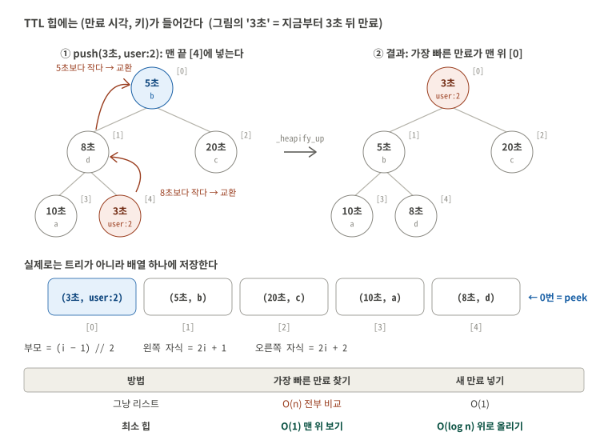

**말하기**
> "만료 처리에서 필요한 질문은 '가장 빠른 만료가 지났나?' 하나입니다. 최소 힙은 가장 작은 만료 시각이 항상 0번에 있어서 O(1)로 볼 수 있고, 넣고 빼기도 O(log n)입니다. 그냥 리스트면 매번 전부 비교해야 합니다. 그리고 맨 위가 아직 안 지났으면 나머지도 전부 안 지난 것이라 바로 멈출 수 있습니다."

**꼬리질문 "DEL하면 힙에서는 어떻게 지워요?"** → "힙 가운데를 찾으려면 O(n)이라 바로 지우지 않습니다. 만료의 정답은 Record의 expire_at이고, 힙 항목은 나중에 꺼낼 때 그 값과 비교해서 다르면 버립니다(lazy deletion). DEL 후 같은 이름으로 다시 SET해도 지워지지 않는 것을 테스트로 확인했습니다."

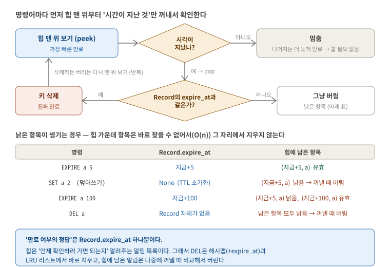

### Q. 메모리 초과 시 eviction 흐름을 단계별로? (used_memory 산정/갱신, LRU 제거, evicted_keys 증가)

**보여줄 곳**: [`store.py`](../mini_redis/store.py) `set`, `_evict_until_fit`, `_delete`

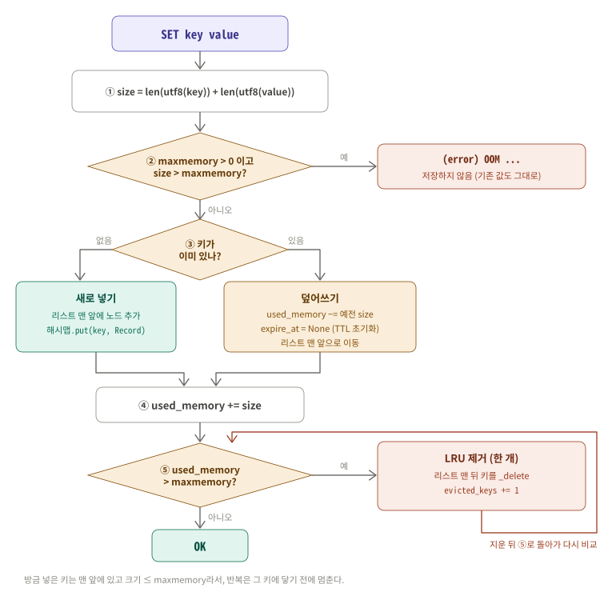


| 단계 | 하는 일 | 과제 예시 (maxmemory 30) |
|---|---|---|
| 1 | size = utf8(키) + utf8(값) 바이트 | user:3 + Charlie = 6 + 7 = 13 |
| 2 | size > maxmemory면 OOM, 저장 안 함 | 13 ≤ 30 통과 |
| 3 | 저장 + 리스트 맨 앞 + used_memory += size (덮어쓰기면 예전 size를 먼저 뺌) | 20 + 13 = 33 |
| 4 | used_memory > maxmemory인 동안 리스트 맨 뒤 키를 `_delete` | user:1 제거 |
| 5 | `_delete`가 해시맵, 리스트에서 빼고 used_memory −= 그 키 size | 33 − 11 = 22 |
| 6 | 제거할 때마다 evicted_keys += 1 | 0 → 1 |
| 7 | 22 ≤ 30이므로 멈추고 `OK` | |

**말하기**
> "SET은 먼저 저장하고 used_memory를 더한 다음, 30을 넘으면 리스트 맨 뒤부터 지웁니다. 지울 때마다 used_memory를 그 키 크기만큼 빼고 evicted_keys를 1 올리고, 30 이하가 되면 멈춥니다. 방금 넣은 키는 맨 앞에 있고 크기가 maxmemory 이하라서 자기 자신이 지워지는 일은 없습니다."

### Q. GET 명령어 전체 흐름을 순서대로? (TTL 확인 → 삭제 여부 → 값 반환 → LRU 갱신 조건)

**보여줄 곳**: [`store.py`](../mini_redis/store.py) `get`, `_get_alive_record`

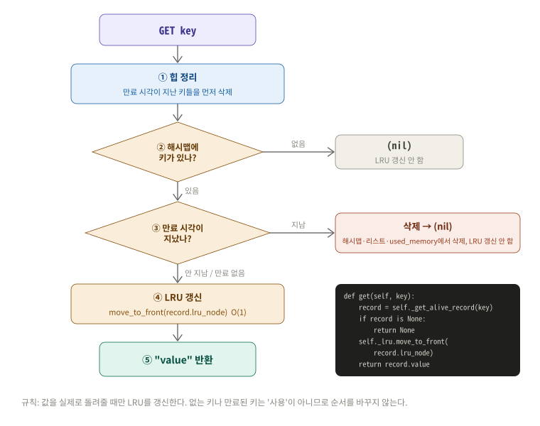

| 순서 | 하는 일 | 결과 |
|---|---|---|
| 1 | 힙 맨 위부터 만료 시각이 지난 키 삭제 | |
| 2 | 해시맵에서 Record 찾기 | 없으면 `(nil)`, LRU 그대로 |
| 3 | Record의 expire_at이 지났는지 확인 | 지났으면 삭제 후 `(nil)`, LRU 갱신 안 함 |
| 4 | 살아 있으면 노드를 리스트 맨 앞으로 | LRU 갱신 |
| 5 | 값 반환 | `"value"` |

**말하기**
> "GET은 TTL 확인 → 만료면 삭제하고 nil → 살아 있으면 LRU를 맨 앞으로 → 값 반환 순서입니다. 핵심은 값을 실제로 돌려줄 때만 LRU를 갱신한다는 것입니다. 만료된 키를 읽으려 한 것은 '사용'이 아니기 때문입니다."

---

## 항목 4. 확장 질문

### Q1. LRU 대신 LFU 정책을 구현한다면 자료구조를 어떻게 바꿔야 하나?

**LFU** = **L**east **F**requently **U**sed = 가장 **적게** 쓴 키부터 지움. LRU는 "언제" 썼는지, LFU는 "몇 번" 썼는지가 기준입니다.

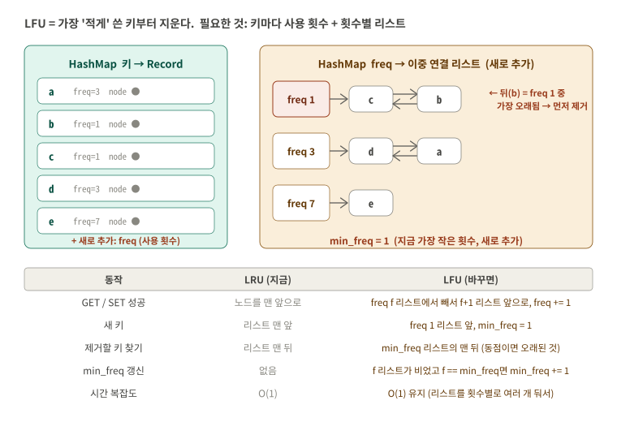

| 바꿀 것 | 내용 |
|---|---|
| Record에 `freq` 추가 | 키마다 사용 횟수 |
| 리스트 1개 → **횟수별 리스트 여러 개** | `freq → 이중 연결 리스트` 해시맵. 같은 횟수끼리는 LRU 순서 (동점 처리) |
| `min_freq` 변수 추가 | 지금 가장 작은 횟수. 제거할 때 바로 그 리스트로 감 |
| GET/SET 성공 시 | freq f 리스트에서 노드를 빼서 f+1 리스트 맨 앞으로. f 리스트가 비었고 f == min_freq면 min_freq += 1 |
| 새 키 | freq 1 리스트 맨 앞, min_freq = 1 |
| 제거 | min_freq 리스트의 맨 뒤 |

**말하기**
> "LRU처럼 리스트 하나에 줄 세우면 횟수 순서를 유지하려고 정렬해야 해서 느려집니다. 그래서 횟수마다 리스트를 따로 두고, 가장 작은 횟수(min_freq)를 기억합니다. 지금 만든 이중 연결 리스트와 해시맵을 그대로 재사용할 수 있고, 모든 연산이 노드 한 개를 옆 리스트로 옮기는 것이라 O(1)을 유지합니다."

**꼬리질문 "힙으로 freq를 관리하면?"** → "가능하지만 GET마다 freq가 바뀌어 힙 안의 위치를 고쳐야 해서 O(log n)이고, 그 항목을 찾는 것도 따로 필요합니다. 횟수별 리스트가 더 빠릅니다."

### Q2. 데이터가 10만 건이면 병목은 어디이고, 어떻게 개선하나?

직접 10만 건을 SET해서 측정했습니다 (Python 3.13, 이 개발 환경에서 1회 측정이라 숫자는 환경마다 다릅니다). 평소 SET 1건은 약 0.02ms, GET은 약 0.002ms로 데이터가 늘어도 일정했습니다.

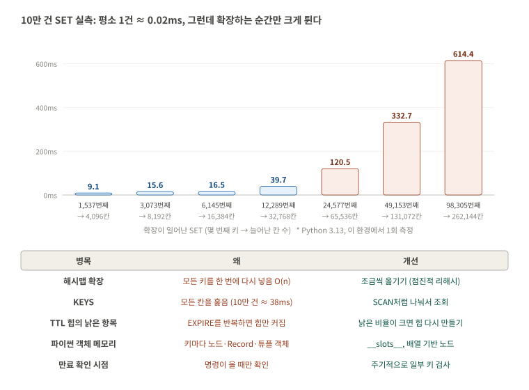

| 병목 | 현재 구조에서 왜 | 개선 |
|---|---|---|
| **해시맵 확장 순간** | 98,305번째 SET 한 번이 약 0.6초. 모든 키를 한 번에 다시 넣음 (O(n)) | **점진적 리해시**: 새 배열을 만들어 두고 명령어마다 몇 칸씩만 옮김 (실제 Redis 방식). 또는 예상 크기로 처음부터 크게 |
| **KEYS** | 26만 칸을 전부 훑음 (약 38ms). 그동안 다른 명령이 멈춤 | 커서로 조금씩 나눠 조회 (Redis의 SCAN) |
| **힙의 낡은 항목** | 키 10개에 EXPIRE를 1만 번 하면 힙 크기 1만 (측정). 메모리와 pop 시간 증가 | 낡은 항목 비율이 크면 힙을 다시 만들기, 또는 키마다 힙 위치를 기억해 바로 고치기 |
| **파이썬 객체 메모리** | 키마다 Record, 노드 2개, Entry 등 객체가 생김 (아래 Q3: 약 53배) | `__slots__`로 객체 크기 줄이기, 노드를 배열 인덱스로 표현 |
| **만료 확인 시점** | 명령어가 올 때만 확인. 아무도 안 부르면 만료 키가 메모리에 남음 | 주기적으로 일부 키만 샘플링해 지우기 (실제 Redis 방식) |

**말하기**
> "평균은 문제없지만 '가끔 한 번 크게 멈추는' 지점이 병목입니다. 대표가 해시맵 확장으로, 10만 건 근처에서 SET 한 번이 0.6초 걸렸습니다. 실제 Redis는 확장을 한 번에 하지 않고 명령어마다 조금씩 옮기는 점진적 리해시로 이 멈춤을 없앱니다. KEYS도 전체를 훑어서 SCAN처럼 나눠야 합니다."

**측정 방법** (직접 해 보려면, 수십 초 걸림)

```bash
python3 -c "
import time
from mini_redis.store import MiniRedis
db = MiniRedis()
for i in range(100000):
    t = time.perf_counter(); db.set('user:%d' % i, 'value%d' % i); d = time.perf_counter() - t
    if d > 0.005: print(i + 1, round(d * 1000, 1), 'ms')
"
```

### Q3. used_memory에 오버헤드까지 포함하면?

**질문 원문**: used_memory에 자료구조 오버헤드까지 포함하는 모델로 바꾸면 무엇이 달라지고, 공정한 비교/채점을 위해 어떤 보정이 필요한가?

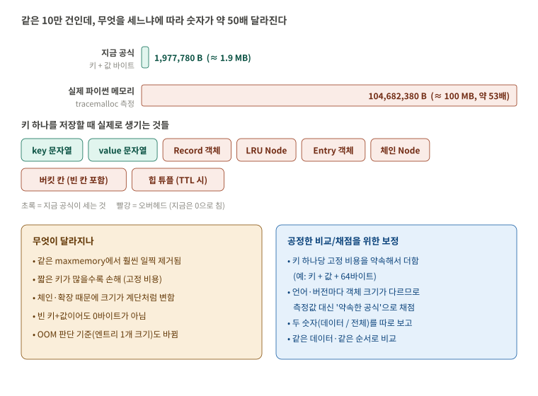

10만 건을 넣고 `tracemalloc`으로 실제 파이썬 메모리를 쟀더니, 공식 값(약 1.9MB)의 **약 53배(약 100MB)**였습니다.

| 달라지는 것 | 설명 |
|---|---|
| 훨씬 일찍 제거됨 | 같은 maxmemory에서 키 1개가 차지하는 양이 커지니, 들어가는 키 수가 크게 줄어듦 |
| 짧은 키가 많을수록 손해 | 오버헤드는 키 길이와 상관없는 고정 비용이라, 작은 키를 많이 넣으면 대부분이 오버헤드 |
| 숫자가 계단처럼 변함 | 버킷 배열이 2배로 커지는 순간 키를 하나만 넣어도 크게 늘어남 |
| 빈 값도 0이 아님 | `SET a ""`도 객체가 생김 |
| OOM 기준 변경 | "엔트리 하나가 maxmemory 초과" 판단에 오버헤드가 들어감 |
| 예측이 어려움 | 파이썬 버전, 운영체제, 64비트 여부에 따라 객체 크기가 다름 |

| 공정한 비교/채점을 위한 보정 | 이유 |
|---|---|
| 측정값 대신 **약속한 공식**으로 계산 (예: 키 + 값 + 키당 고정 64바이트) | 언어와 버전이 달라도 같은 입력이면 같은 숫자 |
| **데이터 크기와 전체 크기를 따로** 보고 | 데이터 공식으로는 채점, 전체 크기로는 효율 비교 |
| 버킷 배열처럼 키 수와 따로 노는 부분은 **별도 항목**으로 | 확장 시점 차이로 결과가 갈리지 않게 |
| 같은 데이터, 같은 명령 순서, 같은 환경으로 비교 | 확장 시점과 LRU 순서가 같아짐 |

**말하기**
> "지금 공식은 키와 값 바이트만 세서 언제 어디서 실행해도 같은 숫자가 나옵니다. 오버헤드를 넣으면 실제 메모리에는 가까워지지만, 파이썬에서는 약 53배라 같은 maxmemory에서 훨씬 일찍 제거되고, 숫자가 언어와 버전마다 달라집니다. 그래서 채점이나 비교에는 '키당 고정 비용' 같은 약속한 공식을 쓰고, 실제 메모리는 따로 보고하는 게 공정합니다."

**측정 방법**

```bash
python3 -c "
import tracemalloc
from mini_redis.store import MiniRedis
tracemalloc.start()
db = MiniRedis()
for i in range(100000):
    db.set('user:%d' % i, 'value%d' % i)
print('used_memory:', db.used_memory, ' python:', tracemalloc.get_traced_memory()[0])
"
```
